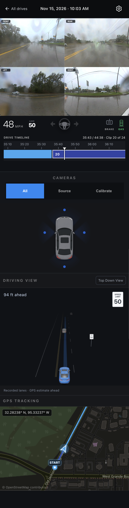
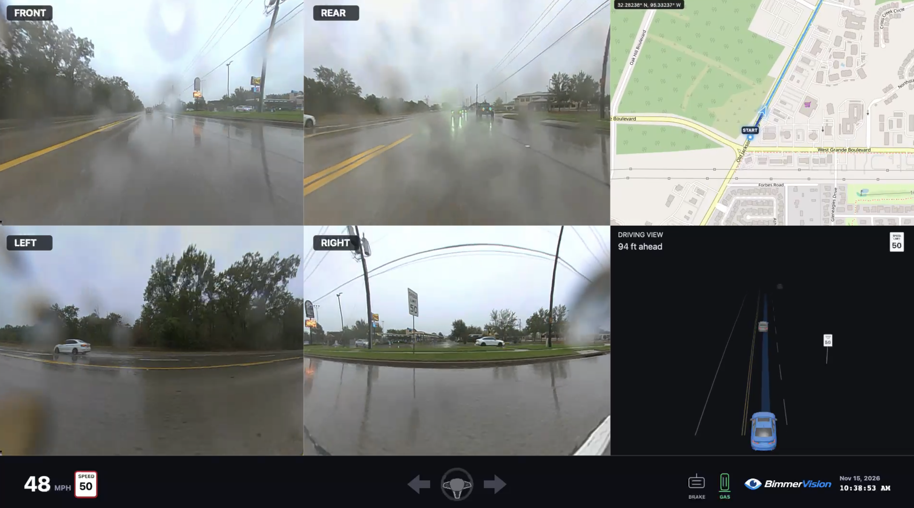

<p align="center">
  
</p>

# BimmerVision Web

**Your BimmerVision recordings, directly in your browser.** A GitHub Pages edition of the BimmerVision player, with the same camera views, drive timeline, telemetry, maps and video export.

## See playback and exports

<table>
<tr>
<td width="30%" valign="top">
<a href="docs/images/playback-mobile.png"></a>
<p><sub>Full mobile playback screen. Select either image to see it at its original size.</sub></p>
</td>
<td width="70%" valign="top">
<h3>Your whole drive, in one place</h3>
<p>Watch the front, rear, left and right cameras together, then choose an individual camera from the top-down vehicle selector. On mobile, the video and compact instrument bar stay pinned while you scroll through the drive timeline, camera controls, Driving view and map.</p>
<ul>
<li><strong>Follow the recording:</strong> scrub the timeline across clips, tap the video to play or pause, or double-tap either edge to skip ten seconds.</li>
<li><strong>Read the instruments:</strong> speed, detected speed limit, turn signals, steering, brake and accelerator activity stay synchronized with the footage.</li>
<li><strong>See the driving context:</strong> the metadata-based 3D view shows the blue driver vehicle, supported traffic detections, lead distance in feet, lane information and recognized road signs.</li>
<li><strong>Review the route:</strong> recorded GPS positions connect the video to its location on the map. Available details depend on the metadata captured by the car.</li>
</ul>
<p><strong>Powered by your BMW’s KAFAS camera data:</strong> Driving View is generated from the built-in KAFAS camera perception data captured in the metadata alongside your recordings, combined with recorded vehicle telemetry and GPS.</p>
<p>The same playback design is available in the car-hosted player and BimmerVision Web. Local USB recordings and metadata are processed in your browser; they are not uploaded to BimmerVision.</p>
<h3>Export the footage and its context</h3>
<p>The example below is a frame from an exported video: all four camera views, the GPS map, Driving view and synchronized instrument overlays, including speed, speed limit, blinkers, steering and pedal activity. Choose the cameras and overlays you want when exporting.</p>
<a href="docs/images/exported-video-metadata.png"></a>
<p><sub>Exported video with camera footage and recorded vehicle metadata.</sub></p>
</td>
</tr>
</table>

## Open the player

**[Launch BimmerVision Web](https://hexphase.github.io/BimmerVision-Web/)**

### From a USB drive

1. Choose **Connect USB drive** on the homepage.
2. Follow the popup: stop recording, safely remove the drive from your BMW, and connect it to this computer.
3. Press **Select Drive**, navigate to your USB drive, and select its **BimmerVision** folder.
4. Pick a drive or expand it to select a recording.

Supported browsers use a read-only directory picker and discover recordings in batches. Other browsers use the compatibility folder picker; no write access is requested.

The browser reads your files locally. **Recordings and vehicle metadata are processed locally in the browser and never uploaded to BimmerVision or stored on its servers.** USB mode is view-only: it cannot erase footage or change the locks on your drive. Camera assignments are saved in this browser; your original files stay unchanged. Online OpenStreetMap tile requests can reveal the map area being viewed; recording files are not sent to the map provider.

You can also select a folder containing a single completed recording. Incomplete clips and recordings whose files do not match their manifest are excluded.

### Directly from your car

Requires **BimmerVision 0.2.8 or newer** on a compatible iDrive 7 car with 360° Surround View cameras.

1. Open **Connect Phone** in the car app and keep that screen open.
2. Join the local Wi-Fi network broadcast by your BMW on this device. This is the car’s own Wi-Fi, not the home Wi-Fi network the car may be connected to.
3. In this web player, enter the car’s IP address and 8-digit code, paste the Connect link, or choose **Scan QR code**.
4. Allow local-network access if the browser asks.

You can scan the QR code with this page’s camera scanner or choose a saved QR-code image. Scanning inside this player keeps you in the hosted web app. Scanning the car’s QR with your phone’s normal camera app opens the car’s built-in player instead.

Use a current **Chrome or Edge** browser for direct car access. An HTTPS-hosted site connecting to the car’s local HTTP server depends on browser local-network permissions. Some browsers block this connection; the connection screen provides a link to the car’s built-in player when needed. Do not disable browser security or certificate checks.

Pairing stays between your device and the car. The web host does not proxy recordings or receive pairing credentials. The car still permits one paired device at a time; reopen Connect Phone for a fresh code if necessary.

## Features

- Front, rear, left and right camera views, or all four together.
- A fixed-scale timeline for scrubbing within and between recordings.
- BMW M colors to distinguish neighboring clips.
- Saved camera calibration for each recording.
- Recorded speed, steering, blinkers, brake, accelerator and timestamped horn information.
- Recorded GPS routes and car-detected speed limits when available.
- An automatic 3D driving visualization, reconstructed from supported recording metadata: blue driver vehicle, surrounding traffic, blinkers, lane changes, and lead distance in feet.
- Desktop playback keeps the camera video and instruments in the left column, the camera selector and Driving view on the upper right, and a taller GPS map below them. Mobile pins the video and a compact instrument bar; the drive timeline, camera selector, Driving view and map scroll beneath them. Tap video to play/pause; double-tap within its outer 18% on either side to seek 10 seconds within the recording.
- A simple All drives back control returns to the library. Export, source selection, settings and diagnostics remain available through the header and options menu.
- Desktop Previous/Next beside Play switch recordings within the current drive; unavailable directions are disabled. Mobile uses the drive timeline to move between recordings. Keyboard left/right arrows still seek within the recording.
- A session-only lookahead cache preloads the next two recordings and advances as you move through the drive. It clears when leaving the drive or changing sources. The cache is bounded to 768 MiB total and 512 MiB per recording; oversized or failed preloads fall back to normal loading. Foreground car transfers take priority, and native MP4 playback preloads the prepared preview. No recordings are uploaded or persistently stored by this cache.
- Recorded parking and wide camera views, with playback and exports following view changes.
- Original BVR + metadata ZIP downloads from USB or a paired car (car app 0.2.15 or newer).
- Recording notices when a car download may interrupt capture.
- Customizable video exports, including date/time and driving overlays. Enable **Driving View** to split the map sidebar into GPS above and synchronized 3D traffic below; export preview shows the current playback frame.
- Full recording download before playback, with visible progress and cancellation.
- Change between USB and car sources without leaving the app.

Player behavior matches the recording webserver in BimmerVision 0.2.37. The hosted player retains local USB access and direct paired-car access.

The homepage footer follows the iDrive app’s version metadata, refreshing online on page load and every 15 minutes while visible. When paired, the connected car’s reported version takes priority. Settings keeps the web build number separate. Offline, the bundled iDrive version remains available; run `npm run sync:idrive-version` alongside an iDrive release to refresh that bundled baseline from the sibling BimmerVision repository.

The driving view follows the same play, pause, and seek controls as the video. Near lanes come from recorded boundaries; the whole recorded GPS route estimates the road ahead. Unknown lane markings and unseen lane purposes are not invented. It does not obtain lane topology from satellite tiles.

Direction uses recorded movement and absolute ground velocity, so passing a slower vehicle does not make it appear oncoming. Vehicle shapes are illustrative, not detected makes or models. Missing or unsupported perception metadata displays an unavailable state. A native MP4 preview reads the original BVR metadata in the background without delaying video playback; this requires an additional raw-recording transfer. WebGL and local vehicle assets are required for 3D rendering. Oversized metadata histories (more than 12,000 samples per signal) report an unavailable driving view rather than silently discarding part of a route. Normal recorder clips fit within this limit.

Recorded sign recognition adds speed-limit, stop, yield, no-entry and supported warning/restriction signs to Driving view and exported videos. Roadside signs use valid camera positions; missing positions appear only in the sign indicator. Camera detections and the fused current-limit result expire after 2.5 seconds without a fresh sample. Moving roadside signs use recorded ego speed between detections. Unsupported or invalid sign types are omitted; stop signs are never inferred from braking. The example drives currently supplied contain speed-limit detections, not recorded stop-sign detections.

See [vehicle asset provenance and redistribution status](assets/vehicles/PROVENANCE.md) before publishing this feature.

The device needs WebCodecs support for camera playback; current Chrome and Edge are recommended. Folder selection and camera-scanning support vary by browser. Maps and update checks use Internet services; unavailable location or speed-limit data stays blank.

## Hosting on GitHub Pages

This is a static website: there is no server process or runtime package installation.

In repository **Settings → Pages**, publish from **main / (root)**. All bundled assets use relative paths so the site works at `/BimmerVision-Web/`. `.nojekyll` keeps the files served directly.

No custom domain is configured by this repository. You can add one through GitHub Pages settings after configuring its DNS. The car companion currently allows the hosted origins `https://hexphase.github.io` and `https://bimmervision.app`; other origins require a corresponding companion update.

## Development

```sh
npm test
python3 -m http.server 8787 --bind 127.0.0.1
```

Open `http://127.0.0.1:8787/`. Localhost is a secure context for browser development. Tests use synthetic data; personal recordings and local exports are ignored by Git.

The player is copied from [BimmerVision](https://github.com/Hexphase/BimmerVision). QR decoding uses vendored [jsQR](https://github.com/cozmo/jsQR), with its Apache 2.0 license and pinned version recorded in `vendor/`.

Run `npm run sync:idrive-version` when preparing an iDrive release to align the Web package, Settings label, source version response and offline footer baseline with that release. An explicit version JSON path can be passed after `--`.
